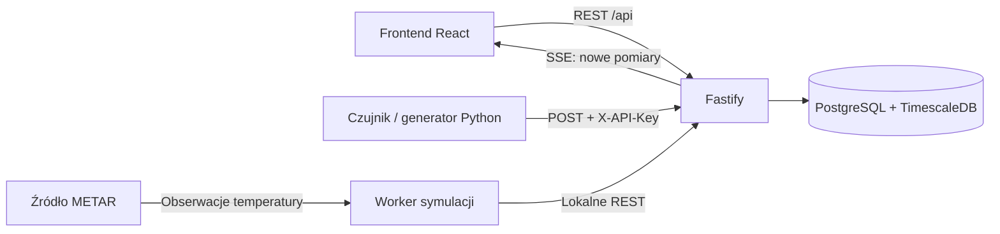

# Architektura aplikacji

## Elementy

RoverSense składa się z frontendu React, API Fastify, bazy PostgreSQL z TimescaleDB oraz niezależnego generatora Python. Frontend i API korzystają ze wspólnego origin: lokalnie żądania `/api` przekazuje proxy Vite, a we wdrożeniu robi to Caddy. Kod frontendu nie łączy się bezpośrednio z bazą.

Worker jest częścią procesu backendu. Diagram wydziela go ze względu na odpowiedzialność, nie jako osobną usługę.

## Backend

`backend/src/server.ts` odczytuje konfigurację, tworzy pulę połączeń, sprawdza obecność schematu i wykonuje odzyskiwanie czujników pozostałych po przerwanych symulacjach. Dopiero potem otwiera port HTTP. Przy zamykaniu najpierw kończy aplikację i jej zadania, a następnie pulę PostgreSQL.

`buildApp()` w `backend/src/app.ts` składa zależności bez samodzielnego uruchamiania serwera. Pozwala to testować trasy przez `Fastify.inject()`. Moduły mają wspólny podział:

- `routes`: ścieżki, schematy wejścia i wymagane uwierzytelnienie;
- `controller`: odczyt żądania oraz statusy i nagłówki odpowiedzi;
- `service`: reguły domenowe, walidacja semantyczna i mapowanie danych;
- `repository`: parametryzowane SQL i operacje transakcyjne.

Obsługa błędów zwraca Problem Details. Walidacja JSON odrzuca błędne typy, a identyfikatory BIGINT są sprawdzane i przenoszone jako tekst, aby nie tracić precyzji.

## Przepływ pomiaru

1. Administrator tworzy serię z zakresem `minValue < maxValue` i przypisuje do niej czujnik.
2. API zwraca klucz urządzenia tylko podczas rejestracji. W bazie zapisuje jego SHA-256.
3. Czujnik wysyła `POST /api/measurements` z `X-API-Key`. Seria wynika z klucza, nie z body.
4. Repozytorium blokuje wiersze czujnika i serii, sprawdza aktywność klucza, zakres wartości i dopuszczalny czas. Zapis jest synchronizowany ze zmianą zakresu serii i wyrejestrowaniem urządzenia.
5. Po zatwierdzeniu pomiar trafia do odpowiedzi REST i do publicznego strumienia SSE. Odrzucenia zakresu lub zbyt odległej przyszłości trafiają do `rejected_measurements`.

Pomiary są przechowywane w hypertable podzielonej według czasu. Szczegóły relacji i kaskad opisuje [model danych](ERD.md).

## Frontend i aktualizacje

`App.tsx` utrzymuje wybór widoku, filtrów, skali i zaznaczonego pomiaru. `useTelemetry()` pobiera migawkę REST, osobno odczytuje ostatnią wartość każdej serii i nasłuchuje SSE. Dane w podsumowaniu ostatnich wartości nie zależą od filtra wykresu.

Podczas pobierania REST `TelemetryReconciler` buforuje zdarzenia osobno dla każdej serii. Zakończona migawka jest łączona wyłącznie ze zdarzeniami odebranymi od jej rozpoczęcia. Zmiana filtrów unieważnia poprzednią generację, a stare odpowiedzi są ignorowane. Po ponownym połączeniu SSE wykonywany jest nowy odczyt REST.

Wykres mierzy kontener przez `ResizeObserver`, przelicza położenie punktów i dobiera liczbę podpisów czasu do szerokości. Tabela grupuje odczyty tej samej chwili w kolumny serii; powtórzenia jednej serii otrzymują osobne wiersze. Zaznaczenie wskazuje ID konkretnego pomiaru.

## Symulacje

Administrator uruchamia zadanie historyczne lub live. Wykonawca rezerwuje miejsce w limicie czterech zadań także na czas przygotowania. Sprawdza serię, opcjonalnie pobiera METAR i rejestruje dedykowany czujnik przez lokalne REST. Pomiary wysyła tą samą ścieżką `POST /api/measurements` co zewnętrzne urządzenie.

`history` nadaje próbkom daty z przeszłości i wysyła je bez przerw. `live` nadaje bieżący czas przez API i czeka pomiędzy próbkami. Dla METAR pobierany jest zestaw obserwacji przy starcie: w historii zachowuje oryginalny czas, a w live odtwarza wartości z czasem transmisji. Generator Python jest osobnym klientem API; backend go nie uruchamia.

Stop anuluje pracę i czeka na sprzątnięcie czujnika. Trwały wpis `simulation_sensor_cleanup` powstaje razem z rejestracją urządzenia. Nieudane wyrejestrowanie jest ponawiane co 5 s. Przy restarcie backend oznacza przerwane zadania jako nieudane, cofa klucze pozostałe w kolejce i opróżnia ją przed przyjmowaniem żądań.

## Ograniczenia i jednostki

| Obszar | Zachowanie |
| --- | --- |
| Procesy | Worker, limit zadań i rejestr SSE zakładają jedną instancję backendu. |
| Historia UI | Do 1000 najnowszych pomiarów na odczyt; paginacja i wydruk obejmują wczytany zestaw. |
| Historia symulacji | Wszystkie aktywne zadania i do 100 ostatnich zakończonych. |
| SSE | Rozsyła nowe pomiary bez trwałego dziennika zdarzeń; przerwę uzupełnia REST. |
| Czas | API wymaga strefy; pomiary są prezentowane w UTC. Formularz dat przyjmuje czas lokalny użytkownika. |
| Interwały | API symulacji używa milisekund; formularz i generator Python — sekund. |
| Wartości | Porównanie procentowe normalizuje każdą serię względem jej własnego zakresu. Tryb raw pokazuje jedną serię. |
| Healthcheck | Potwierdza działanie procesu HTTP; nie sprawdza połączenia z bazą przy każdym żądaniu. |
| Dane DEV | Podgląd `?preview=1` działa tylko w Vite DEV i nie zapisuje danych do API. |
