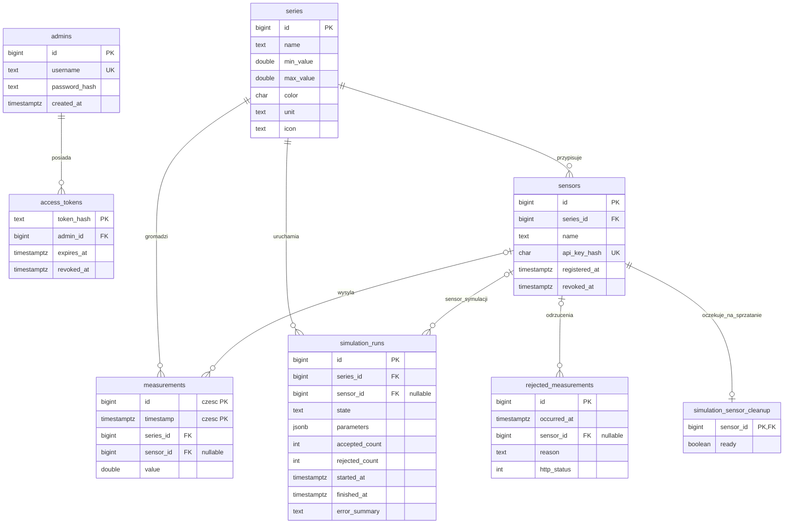

# RoverSense — model danych i diagram ERD

Diagram odpowiada migracjom `database/migrations/001_initial.sql` i `002_simulation_sensor_cleanup.sql` w PostgreSQL 17 z rozszerzeniem TimescaleDB. Tabela measurements jest hypertable dzieloną według timestamp.

Diagram przedstawia dane aplikacji. Techniczna tabela `schema_migrations`, tworzona przez runner migracji, przechowuje nazwy zastosowanych plików SQL i daty ich wykonania; nie ma relacji z danymi domenowymi.

## Relacje i integralność

- Usunięcie serii usuwa powiązane czujniki, pomiary i uruchomienia symulatorów (FK ON DELETE CASCADE).
- Usunięcie sensora ustawia sensor_id na NULL w measurements, simulation_runs i rejected_measurements (ON DELETE SET NULL), a jego wpis w simulation_sensor_cleanup usuwa kaskadowo (ON DELETE CASCADE). **Wyrejestrowanie** sensora nie usuwa jego rekordu — ustawia revoked_at, usuwa wpis kolejki sprzątania, a dotychczasowe pomiary pozostają.
- simulation_sensor_cleanup ma najwyżej jeden wpis na czujnik: sensor_id jest jednocześnie kluczem głównym i obcym. Nie przechowuje klucza API.
- Tokeny dostępu są powiązane z kontem administratora i usuwane wraz z nim.
- Klucz główny measurements obejmuje **(timestamp, id)** z powodu wymagań hypertable; osobny indeks przyspiesza odczyt po id.
- Indeks measurements_series_time_idx przyspiesza filtrowanie serii i czasu. Ograniczenie CHECK (min_value < max_value) dotyczy serii, a zakres pomiaru jest walidowany transakcyjnie przez backend.
- password_hash, api_key_hash i token_hash przechowują skróty, nigdy jawne hasła czy klucze.

## Sprzątanie czujników symulacji

Wpis simulation_sensor_cleanup powstaje w tej samej transakcji co rejestracja czujnika przez lokalnego workera, jeszcze przed utworzeniem simulation_runs. Dzięki temu kolejka obejmuje również czujniki, dla których zapis uruchomienia symulacji się nie powiódł. Ręcznie rejestrowane czujniki nie trafiają do kolejki.

Pole ready ma domyślnie wartość false; przed próbą wyrejestrowania jest ustawiane na true. Nieudane operacje są ponawiane przez REST. Ponawianie obejmuje także wpisy powiązane z zakończonymi zadaniami, nawet gdy ustawienie ready się nie powiodło. Udane wyrejestrowanie usuwa wpis kolejki w tej samej transakcji, w której unieważnia klucz czujnika. Przy starcie backend unieważnia klucze wszystkich czujników pozostałych w kolejce i opróżnia ją przed przyjmowaniem żądań.

## Ścieżka pomiaru

Generator Python lub backendowy symulator wysyła POST /api/measurements z nagłówkiem X-API-Key. Backend weryfikuje klucz oraz zakres serii i zapisuje wynik w TimescaleDB. Publiczny dashboard pobiera dane przez GET /api/measurements i nasłuchuje /api/events (SSE). Interfejs nie pozwala ręcznie edytować pojedynczych wyników.

## Utrzymanie schematu

Wersje schematu opisują migracje w `database/migrations/`, uruchamiane jawnie przez runner backendu. Zmianę modelu należy opisać nową migracją i zaktualizować diagram. Sam start API nie tworzy tabel. Tokeny wygasłe, historia symulacji i odrzuceń nie mają automatycznej retencji w kodzie aplikacji.
