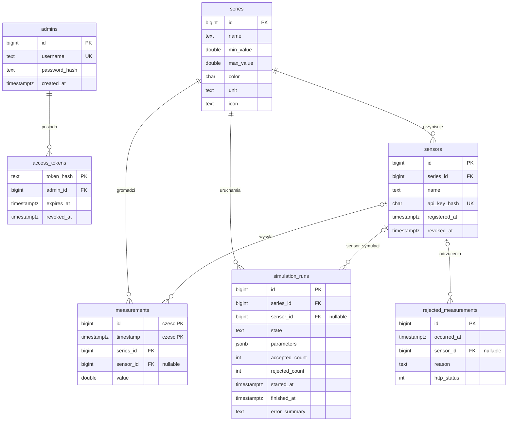

# RoverSense — model danych i diagram ERD

Diagram odpowiada migracji database/migrations/001_initial.sql w PostgreSQL 17 z rozszerzeniem TimescaleDB. Tabela measurements jest hypertable dzieloną według timestamp.

## Relacje i integralność

- Usunięcie serii usuwa powiązane czujniki, pomiary i uruchomienia symulatorów (FK ON DELETE CASCADE).
- Usunięcie sensora ustawia sensor_id na NULL w zależnych tabelach (ON DELETE SET NULL). **Wyrejestrowanie** sensora nie usuwa jego rekordu — ustawia revoked_at, a dotychczasowe pomiary pozostają.
- Tokeny dostępu są powiązane z kontem administratora i usuwane wraz z nim.
- Klucz główny measurements obejmuje **(timestamp, id)** z powodu wymagań hypertable; osobny indeks przyspiesza odczyt po id.
- Indeks measurements_series_time_idx przyspiesza filtrowanie serii i czasu. Ograniczenie CHECK (min_value < max_value) dotyczy serii, a zakres pomiaru jest walidowany transakcyjnie przez backend.
- password_hash, api_key_hash i token_hash przechowują skróty, nigdy jawne hasła czy klucze.

## Ścieżka pomiaru

Generator Python lub backendowy symulator wysyła POST /api/measurements z nagłówkiem X-API-Key. Backend weryfikuje klucz oraz zakres serii i zapisuje wynik w TimescaleDB. Publiczny dashboard pobiera dane przez GET /api/measurements i nasłuchuje /api/events (SSE). Interfejs nie pozwala ręcznie edytować pojedynczych wyników.

*To źródło diagramu do przyszłego PDF, a nie gotowe zgłoszenie E2.*
